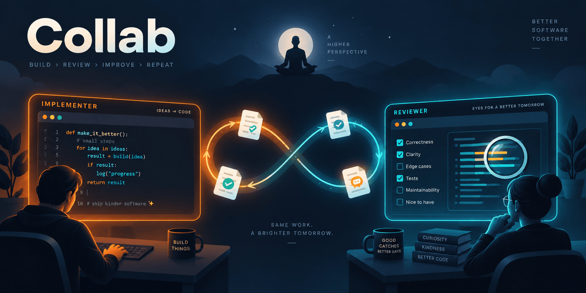

<p align="center">
  
</p>

<h1 align="center">Collab</h1>

<p align="center">
  <b>Pair programming for AI coding agents: one builds, the other reviews the real changes and steers it.</b><br>
  You watch, step in whenever you like, and only get asked when a choice is yours.
</p>

<p align="center">
  <a href="https://github.com/Hokken/collab-skill/actions/workflows/test.yml"></a>
  = 18">
  
  <a href="LICENSE"></a>
</p>

<p align="center">
  <a href="#quick-start">Quick start</a> ·
  <a href="#what-a-run-looks-like">What a run looks like</a> ·
  <a href="#everyday-use">Everyday use</a> ·
  <a href="#command-reference">Commands</a> ·
  <a href="#faq">FAQ</a>
</p>

---

## What you get

Collab brings **pair programming** to coding agents. The idea is the same as with two human
developers: one *drives* (writes the code), the other *navigates* (reads it critically). Two
perspectives catch what one misses. The navigator questions implementation choices, brings
insights from another angle, and the pair settles on an implementation both agree on before it
counts as done. Using two different agents (say **Claude Code** and **Codex CLI**) makes those
perspectives genuinely different.

**Collab turns that into a loop that runs by itself**: you give a task to one agent, start the
other as the reviewer, and they work it through together until the reviewer approves, then move
on to the next task.

It's more than taking turns:

```text
                    You:  collab watch · collab note · answer decisions
                         │                                       │
                         v                                       v
  ┌──────────────────────────┐   hand off: summary    ┌──────────────────────────┐
  │       Implementer        │ ─────────────────────> │         Reviewer         │
  │  builds, runs checks,    │                        │  reads the real git diff │
  │  posts progress          │ <───────────────────── │  numbered findings,      │
  │                          │   changes / approve    │  or approve              │
  │                          │ < ─ ─ ─ ─ ─ ─ ─ ─ ─ ─  │                          │
  └──────────────────────────┘  note, mid-turn (opt.) └──────────────────────────┘
```

- **The reviewer reads the real code.** Collab snapshots your git repos when a task starts, so
  the review covers what actually changed, not what the implementer says it changed.
- **Steering goes both ways, mid-flight.** You can send the agents a note at any time with
  `collab note "…"`, and the reviewer can send the implementer one too, for example after looking
  at the live diff when you ask it to ([how](#while-it-runs)). A note reaches the agent at its next step and must be acknowledged
  (`Note #N`) before it can hand off, so nothing is silently ignored.
- **You stay in charge without babysitting.** When a choice is really yours (product behaviour,
  an ambiguous requirement), the pair asks with a short list of options and carries on once you
  pick one.

## Quick start

**You need:** Node.js 18+, git, and two agent CLIs that load
[agent skills](https://docs.claude.com/en/docs/claude-code/skills), e.g. **Claude Code** and
**Codex CLI** (either can take either role).

### Install

```bash
# macOS / Linux
git clone https://github.com/Hokken/collab-skill.git
cd collab-skill && ./install.sh
```

```powershell
# Windows (PowerShell)
git clone https://github.com/Hokken/collab-skill.git
cd collab-skill; powershell -ExecutionPolicy Bypass -File .\install.ps1
```

The installer links the skill into Claude Code and Codex and puts a `collab` command in
`~/.local/bin`. If that folder isn't on your PATH, it tells you what to add (on Windows it offers
to add it). Then **open a new terminal** (on Windows, restart VS Code too) and restart your agent
sessions so they load the skill. Check it with:

```bash
collab help
```

<details>
<summary>Prefer the <a href="https://skills.sh">skills</a> installer?</summary>

```bash
npx skills add Hokken/collab-skill -g --agent claude-code codex
~/.agents/skills/collab/install.sh      # puts the `collab` command on your PATH
```

On Windows, run `~\.agents\skills\collab\install.ps1` for the second step. Update later with
`npx skills update`. With the git install, updating is just `git pull`. Windows tips:
[docs/windows.md](docs/windows.md).

</details>

### Run your first task

Open three terminals in your project folder.

1. **Reviewer** (terminal 1). Start Codex and send:
   ```text
   $collab review
   ```
   It waits for a task to appear. Leave it running.

2. **Implementer** (terminal 2). Start Claude Code and send your task:
   ```text
   /collab implement Add input validation to the signup form, with tests.
   ```
   Or send `/collab implement` on its own and describe the task when it asks. (With queued
   tasks, it starts the first one instead.)

3. **You** (terminal 3, optional):
   ```bash
   collab watch                          # live dashboard
   collab note "keep the public API unchanged"   # steer at any time
   ```

That's it. The implementer writes a brief and starts; the two hand the work back and forth until
the reviewer approves. You get a desktop notification when it's done or when they need you.

> [!TIP]
> Let the agents run without permission prompts (Claude Code's auto mode, or allow
> `Bash(collab:*)`), otherwise every handoff stops to ask you.

Roles swap freely: `/collab review` in Claude Code and `$collab implement …` in Codex works just
as well. Want the approach agreed before any code? Add `--plan`:
`/collab implement --plan Add input validation to the signup form, with tests.`

## What a run looks like

The timeline of a task in `collab watch` (illustrative: `human` is your note, `peer` a
mid-turn note from the reviewer, which it *can* send but most tasks don't need):

```text
  #000  implementer  brief             Add input validation to the signup form…
  #001  human        note-all          Use zod, it's already a dependency
  #002  peer         note-implementer  Your diff touches src/api/users.ts, outside the form…
  #003  implementer  ready             Added zod schema, 9 tests (Note #1 zod, Note #2 reverted)
  #004  reviewer     changes           1. [blocking] email regex accepts "a@b" …
  #005  implementer  ready             Fixed 1: switched to zod .email(), +2 tests
  #006  reviewer     approve           Verdict: approved ✔

  🔔 collab: DONE
```

Nobody copy-pasted anything. Every step, in full, stays browsable in the dashboard
(↑↓ steps, ←→ earlier tasks) and in `collab log`. At the end of the run you get one report:
what was delivered, what was verified, every decision taken and what to check by hand.

## Why it works

- **Reviews the real changes.** Diffs come from a git snapshot taken at the start of the task,
  nested repos included. Files outside a task's `--scope` are flagged.
- **Approval means what it says.** An approval covers the exact files the reviewer saw. If they
  change afterwards, the approval is refused, and `collab verify` checks again before a commit.
- **Honest handoffs.** Each handoff states what was verified, what was attempted, what was
  deferred and what isn't claimed. The reviewer treats a false "verified" as a blocking issue.
- **Notes can't get lost.** Every note must be acknowledged as `Note #N`, even if the agent
  missed the output it arrived in. An agent's note is always labelled as the agent's, never as yours.
- **Asks instead of guessing, and doesn't argue forever.** Choices that are yours come to you as
  numbered options. After 4 review rounds (configurable) you pick: 2 more rounds, approve as it is, or stop.
- **Learns your project.** Recurring findings become *project lessons*, put into every later brief.
- **Never stuck silently.** Agents post progress. If one goes quiet, the other asks you whether
  to keep waiting.
- **Cheap and tiny.** Waiting is a blocking shell command, so it costs no tokens. One Node.js file,
  no dependencies, macOS, Linux and Windows.

## Everyday use

### Task options

Add these to `/collab implement …` or to `collab queue add`:

| Option | What it does |
|---|---|
| `--plan` | The reviewer approves a plan before any code is written |
| `--check "npm test"` | Must pass before each implementation handoff (`ready`). Collab runs it and refuses that handoff on failure |
| `--scope "src/auth/**"` | Files the task may change. `collab diff` flags anything outside, and the reviewer treats it as blocking |
| `--focus "security"` | What the reviewer should look at hardest |
| `--branch feat/x` | Work on this branch |
| `--commit` | Commit the changes when the task is done (never pushes) |
| `--confirm` | Queued tasks only: ask you before this one starts |
| `--phone` | Push to your phone when you're needed (see [Phone notifications](#phone-notifications)); stays on for the rest of the run |
| `--max-rounds N` | Review rounds before you are asked: more rounds, approve, or stop (default 4) |
| `--first` | Queued tasks only: put it at the front of the queue |

Example: `/collab implement --check "npm test" --scope "src/auth/**" fix the login redirect`.

### Queue up a morning's work

```bash
collab queue add --branch feat/validation --check "npm test" --commit "Add signup form validation"
collab queue add --plan --focus security --scope "src/auth/**" "Refactor the auth middleware"
collab queue add --confirm "Run the DB migration for user roles"
```

Then start the pair with `/collab implement` and no task. The implementer takes the first queued
task, and when it's done moves on to the next one; the reviewer follows. An escalated task pauses
the queue until you've had a look. Add tasks any time, even while they work. Manage it with
`collab queue`, `queue rm 2`, `queue move 3 1` and `queue clear`.

Big jobs split themselves: if a task is too big to review in one go, the implementer splits it
with `collab queue split`, keeps part 1, queues the rest right after with the same options, and
tells you how it split the work.

### While it runs

```bash
collab watch                                  # dashboard (↑↓ steps · ←→ tasks · space scroll · q quit)
collab note "keep the public API unchanged"   # tell both agents something new
collab note -r "be strict on accessibility"   # just the reviewer (-i = just the implementer)
collab answer 2                               # pick option 2 of a pending decision
collab status                                 # one-line summary
collab diff --stat                            # what actually changed in your code
collab log                                    # the full conversation between the agents
collab abort                                  # stop both agents
```

Want the reviewer to look at the work in progress? While it waits for its turn, the reviewer is
blocked in `collab wait` and only sees notes for it when its turn comes, so a `collab note -r`
steers its *next* review, it doesn't wake it up. To get an early look, talk to the reviewer
directly in its own terminal (interrupt it and ask it to check `collab diff` now). It can then
send the implementer a note (`collab note --from reviewer`), which reaches the implementer at its
next progress update and must be acknowledged before it hands off.

### Project lessons

When a review turns up something a future task in the same project would also get wrong (a
convention, a recurring mistake), the agents record it as a *lesson*. Every new brief includes the
project's lessons, and the reviewer checks the work against them. Your instructions and the
project's own rules (`CLAUDE.md`, `AGENTS.md`) always come first.

```bash
collab lessons                                # list this project's lessons
collab lessons add "Never edit generated files in src/gen/"
collab lessons rm 4                           # drop one that's wrong or outdated
```

They live in `.collab/lessons.md` in your repo: commit it and every teammate gets them.
File format and editing rules: [docs/reference.md](docs/reference.md#the-lessons-file).

### Phone notifications

Add `--phone` to a task and you get a push, through the free [ntfy](https://ntfy.sh) app (no
account), when a decision is waiting, a task is escalated or stalls, an agent goes quiet, and
when the run is done. Ordinary handoffs stay silent. The first time, the implementer gives you a
private topic to subscribe to; `collab phone test` sends a test push.

To also hear about an agent stuck on its own permission prompt, add a small hook to Claude Code
or Codex: see [docs/reference.md](docs/reference.md#hooks-for-agent-permission-prompts).

## Command reference

The same list as `collab help`, grouped by what you'd use it for. 🤖 marks commands the agents
also run themselves. Add `-t <task-id>` to any command to target a task other than the current one.

**Watch and steer**

| Command | What it does |
|---|---|
| `collab watch [--interval S]` | Interactive dashboard: steps (↑↓), tasks (←→), live progress |
| `collab note "text" [-i \| -r]` | Tell the agents something new (both by default; `-i` just the implementer, `-r` just the reviewer). Each must be acknowledged as `Note #N` in the agent's next handoff. 🤖 agents use `--from <role>` to reach the other agent |
| `collab answer <N \| text>` | Answer a pending decision: option N, or your own words. 🤖 when you pick an option in Claude Code |
| `collab snooze [MIN]` | Keep waiting on a slow agent: no idle prompt for MIN minutes (default 30). 🤖 when you answer *keep waiting* |
| `collab abort` | Stop the current task; both agents exit their loop. 🤖 when you answer *stop* |

**Look at a task**

| Command | What it does |
|---|---|
| `collab status` | One-shot summary of the current task. 🤖 after an unexpected exit code |
| `collab log` | Full history: brief, summaries, reviews, notes |
| `collab show [N]` | Print entry #N (default: the latest one) |
| `collab diff [--stat] [--all] [--since-review]` | What changed in the project since the task started. Lockfile patches are left out unless `--all`; `--since-review` shows only what changed since the last review. 🤖 the reviewer, on every review |
| `collab list` | All tasks (`*` = current) with status and round |
| `collab path` | Folder holding the current task's files |

**Queue and housekeeping**

| Command | What it does |
|---|---|
| `collab queue` | List queued tasks (`*` = this project) |
| `collab queue add [options] "task"` | Queue a task; the implementer starts it after the current one (see [Task options](#task-options)) |
| `collab queue rm N` · `move N M` · `clear [--all]` | Edit the queue |
| `collab lessons [add "text" \| rm N]` | List, add or remove this project's lessons (see [Project lessons](#project-lessons)) |
| `collab phone [set <topic \| url> \| test \| send]` | Show, change or test where `--phone` tasks push to; `send` is for agent CLI hooks (see [Phone notifications](#phone-notifications)) |
| `collab clean [--older-than D] [-n] [-y]` | Delete finished tasks and drafts older than a day (asks first; `-n` dry run, `-y` no prompt) |
| `collab help` | Print the command list |

<details>
<summary><b>Commands the agents run</b> (the skill handles these; you normally don't need them)</summary>

| Command | What it does |
|---|---|
| `collab init <slug> [options] [--from-queue [--confirmed "answer"]]` | Start a task (brief on stdin or `--file`) |
| `collab queue next` · `queue skip` | Show / drop the next queued task for this project |
| `collab queue split [--reason TEXT]` | Implementer: split the current task (parts on stdin, separated by `=== part ===` lines); part 1 stays, the rest queue next |
| `collab check` | Run the task's `--check` command |
| `collab verify` | Implementer: are the project files still the ones the reviewer approved? Exit 0 yes, 17 no. Run before a `--commit` commit |
| `collab scratch` | Folder for message drafts, notes and logs: the task's own, or a shared drafts folder before `init`. Keeps them out of your project |
| `collab join [--after ID] [--force]` | Reviewer: wait until a task exists, print its brief. Refused when the task already has a live reviewer (`--force` takes over from a dead one). With `--after` (the task it just finished), it also stops when the run ends |
| `collab end` | Implementer: the whole request is done. Ends the run for both agents (final report on stdin or `--file`) |
| `collab wait <implementer\|reviewer>` | Block until it's that agent's turn (or the task ends) |
| `collab progress "text"` | Post what it's doing now (shown to the other side and in `watch`) |
| `collab note --from <role> "text"` | Send a note to the other agent mid-turn (labelled as the agent's, never as yours) |
| `collab submit implementer <plan\|ready\|decide\|escalate>` | Hand off the turn (message on stdin or `--file PATH`) |
| `collab submit reviewer <changes\|approve\|decide\|escalate>` | Hand off the turn. `decide` asks you to pick a numbered option (`--self`: the asking agent shows the choice itself). `approve` is refused (exit 17) if the files changed since the implementer's handoff; `approve --rereviewed` after checking them |

Exit codes: `0` ok · `10` finished · `11` wait timed out · `12` note not acknowledged · `13` other
agent idle · `14` check failed · `15` queue empty · `16` decision for the user · `17` files changed
since review/approval · `1` error. See [docs/how-it-works.md](docs/how-it-works.md#exit-codes).

</details>

## FAQ

**Which models do they use?**
Whatever each CLI is set to. Collab never changes models. A strong reviewer with high reasoning
effort is usually worth it: reviews are short and missed bugs are expensive.

**Does it cost a lot of tokens?**
Not for the coordination. Waiting is a plain shell command, so an agent spends nothing while the
other works. You pay for the actual implementing and reviewing, as you would by hand.

**What if they disagree forever?**
They can't. After the round limit (default 4, `--max-rounds N`) you pick: 2 more rounds, approve
as it is, or stop. Before that, they settle technical calls themselves (the safest option, noted
in the final report) and ask you right away about choices that are really yours.

**What if an agent crashes or hangs?**
If the working agent goes quiet (no handoff, no progress update, no file changes for a while), the
waiting agent asks you whether to stop or keep waiting. `collab abort` always stops both.

**Can I still talk to the agents directly?**
Yes. Typing into either CLI works for quick, agent-specific tweaks. Use `collab note` for anything
both agents need to know, such as new requirements or scope changes, so the reviewer doesn't flag
your instructions as scope creep. (Running `collab note` from inside an agent's own shell needs
`--as-user`, so an agent can never post as you.)

**Does it commit or push for me?**
Only if you ask: with `--commit`, the implementer commits a task's changes once it's approved and
verified. Collab never pushes. Otherwise the agents follow your usual rules (`CLAUDE.md`, `AGENTS.md`).

**Can I run two pairs at once?**
Yes. Each agent pins its own task id, so pairs in different projects don't interfere.

**Can I change the timeouts and limits?**
Yes, with environment variables (`COLLAB_MAX_ROUNDS`, `COLLAB_IDLE_SECS`, `COLLAB_NOTIFY=0`, …).
The full list is in [docs/reference.md](docs/reference.md#configuration).

## How it works

Each agent runs the same skill ([`SKILL.md`](SKILL.md)), and the two coordinate through a small
state folder (`~/.collab`) that the `collab` CLI manages. When it's not their turn, they block on
`collab wait`. When it is, they work, post progress, and hand off with `collab submit`. The CLI
enforces the protocol: whose turn it is, notes acknowledged, checks passed, approvals matching
the files.

Want the details, or to adapt it to other agents? See [docs/how-it-works.md](docs/how-it-works.md).

## Contributing

Issues and pull requests are welcome. The whole tool is [`bin/collab.js`](bin/collab.js) plus
[`SKILL.md`](SKILL.md).

```bash
npm test      # ~30 s, no dependencies to install
```

Please keep it dependency-free and cross-platform. CI runs the tests on macOS, Linux and Windows.

## License

[MIT](LICENSE)
